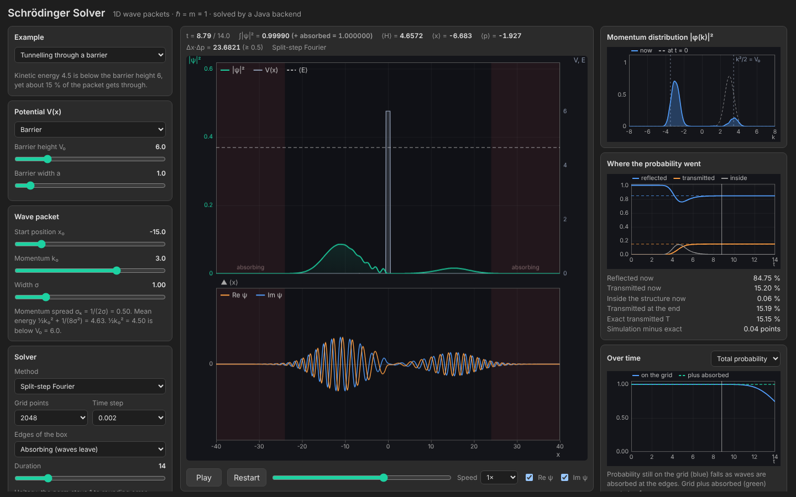

# Schrödinger Solver

An interactive solver for the one-dimensional time-dependent Schrödinger equation. Send a Gaussian wave packet at a
barrier, a step, a well, a double barrier, or let it oscillate in a harmonic or double-well potential, and watch
$|\psi|^2$, $\mathrm{Re}\,\psi$ and $\mathrm{Im}\,\psi$ evolve. Three numerical methods can be compared, and the
scattering runs are checked against exact transmission coefficients.

The **backend is Java** (JDK only, no libraries): it runs the simulation and serves the API. The **frontend is plain
HTML, CSS and JavaScript** in separate files.



## Run it

You need Java 17 or newer (for example from https://adoptium.net).

**Double-click `schrodinger-solver.jar`.** No console window opens: the server starts, your browser opens at
http://127.0.0.1:8006 and the server quits by itself when you close the tab. The jar contains the pages too, so
you can copy it anywhere and it still works on its own. If something goes wrong (for example the port is in use)
a message box says what.

If a `frontend` folder is found next to the jar (or in the folder you start it from), that folder is used instead of
the packed copy, so you can edit the HTML, CSS and JavaScript and just refresh the page.

If your system does not open `.jar` files on double-click, start it from a terminal in this folder:

```
java -jar schrodinger-solver.jar
```

To build from source you need a JDK (not just Java), version 17 or newer. From the project folder, create
`build/classes` and `build/input` first, then:

```
javac --release 17 -encoding UTF-8 -d build/classes backend/src/main/java/schrodinger/*.java
jar --create --file build/input/schrodinger-solver.jar --main-class schrodinger.Main -C build/classes . -C . frontend
```

For a standalone app that needs no installed Java, continue with:

```
jlink --add-modules java.base,java.desktop,jdk.httpserver --strip-debug --no-header-files --no-man-pages --output build/runtime
jpackage --type app-image --name SchrodingerSolver --input build/input --main-jar schrodinger-solver.jar --main-class schrodinger.Main --runtime-image build/runtime --dest dist
```

Options (add them after the command, for example `java -jar schrodinger-solver.jar --port 9000`): `--port 9000`,
`--no-browser`, `--no-watchdog`, `--frontend <folder>`, `--help`.

## What you see

- **Wave packet:** $|\psi|^2$ drawn over the potential $V(x)$ with the mean energy $\langle H\rangle$ as a dashed
  line and $\langle x\rangle$ marked, and below it $\mathrm{Re}\,\psi$ and $\mathrm{Im}\,\psi$.
- **Momentum distribution** $|\phi(k)|^2$ now and at $t=0$. Tunnelling and reflection show up as the packet
  splitting into pieces with the same $|k|$.
- **Where the probability went:** reflected, transmitted and inside the structure over time, next to the exact
  transmission $T$ for the chosen packet.
- **Over time:** total probability, energy, $\langle x\rangle$ (with the exact classical curve for the oscillator)
  or $\Delta x\,\Delta p$.
- **Examples:** tunnelling, over-the-barrier reflection, a step, a well, resonant tunnelling through a double
  barrier, a coherent state in a harmonic trap, a free spreading packet, tunnelling in a double well, and forward
  Euler blowing up.

## The physics

With $\hbar = m = 1$ the equation is

$$
i\,\frac{\partial \psi}{\partial t} = \hat H\psi = -\frac{1}{2}\frac{\partial^2 \psi}{\partial x^2} + V(x)\,\psi
$$

The packet starts as a Gaussian with position $x_0$, mean momentum $k_0$ and width $\sigma$:

$$
\psi_0(x) = (2\pi\sigma^2)^{-1/4}\,e^{-(x-x_0)^2/(4\sigma^2)}\,e^{i k_0 x}
$$

Its momentum spread is $\sigma_k = 1/(2\sigma)$, its mean energy is $\tfrac12 k_0^2 + 1/(8\sigma^2)$ and
$\Delta x\,\Delta p = \tfrac12$ at $t=0$. In free space the width grows as $\sigma\sqrt{1 + (t/2\sigma^2)^2}$.

### Methods

**Split-step Fourier.** One step of size $\Delta t$ is a symmetric (Strang) splitting of $e^{-i\hat H\Delta t}$:

$$
\psi(t+\Delta t) \approx e^{-iV\Delta t/2}\;\mathcal F^{-1}\!\left[e^{-ik^2\Delta t/2}\,\mathcal F\!\left[e^{-iV\Delta t/2}\psi(t)\right]\right]
$$

It is unitary (the norm stays 1 to rounding error), exact in space and has an error $O(\Delta t^2)$ in time. The
FFT treats the box as periodic. The energy wobbles slightly near sharp edges, which is that time error.

**Crank–Nicolson.** The implicit midpoint rule with a three-point second derivative:

$$
\left(1 + \frac{i\Delta t}{2}\hat H\right)\psi^{n+1} = \left(1 - \frac{i\Delta t}{2}\hat H\right)\psi^{n}
$$

The matrix is tridiagonal, so each step is one Thomas-algorithm solve. It is unitary, second order in $\Delta t$ and
in $\Delta x$, and has hard walls at the ends of the box.

**Forward Euler.** $\psi^{n+1} = (1 - i\hat H\Delta t)\,\psi^n$ multiplies each eigencomponent by
$\sqrt{1 + E^2\Delta t^2} > 1$, so the norm grows at every step whatever $\Delta t$ is. The run stops when the norm
passes $10^6$.

### Edges of the box

**Absorbing:** a complex potential $V \to V - iW$ with $W = 2u^2$ ramps up from $|x| = 24$ to the edge
($u$ is the distance into the layer divided by its length). The probability removed is tracked on each side, so
"on the grid + absorbed" stays 1.
**Reflecting walls:** a smooth $V = 150\,u^4$ from $|x| = 34$.

### Exact scattering check

For piecewise-constant potentials the wave function is a combination of $e^{\pm ikx}$ in each region, and matching
$\psi$ and $\psi'$ at every edge gives the transmission $T(k)$. For the packet, the exact long-time transmitted
probability is

$$
T = \int |\phi(k)|^2\,T(k)\,dk
\qquad
|\phi(k)|^2 = \frac{1}{\sqrt{2\pi}\,\sigma_k}\,e^{-(k-k_0)^2/(2\sigma_k^2)}
$$

For a single barrier with $E < V_0$ this reduces to the textbook

$$
T(k) = \left[1 + \frac{V_0^2\sinh^2(\kappa a)}{4E(V_0 - E)}\right]^{-1}
\qquad
\kappa = \sqrt{2(V_0 - E)}
$$

The check is shown only when the packet's momentum is far enough from zero that it does not reach back across it.

## API

`GET /api/simulate` with query parameters returns one binary reply: an int32 length $L$ (little-endian), $L$ bytes of
JSON (padded to a multiple of 4) with all the per-frame quantities, then every frame as float32:
$|\psi|^2$, $\mathrm{Re}\,\psi$, $\mathrm{Im}\,\psi$ at $m$ display points, followed by $|\phi(k)|^2$ at $m_k$ bins.

| Parameter | Values |
| --- | --- |
| `potential` | `free`, `step`, `barrier`, `well`, `double_barrier`, `harmonic`, `double_well` |
| `v0`, `width`, `gap`, `omega` | height 0 to 100, width 0.05 to 30, gap 0.05 to 40, $\omega$ 0.05 to 5 |
| `x0`, `k0`, `sigma` | $\pm 25$, $\pm 8$, 0.2 to 8 |
| `method` | `split`, `cn`, `euler` |
| `n`, `dt`, `tmax` | 512, 1024, 2048 or 4096 points; 0.0005 to 0.05; 0.5 to 80 |
| `edges` | `absorbing`, `walls` |

`POST /api/ping` and `POST /api/bye` keep the server alive or tell it the tab closed. Bad input gives a JSON error.

## Project structure

```
.
├── backend/src/main/java/schrodinger/
│   ├── Main.java             # command line, finds the frontend, opens the browser, watchdog
│   ├── Server.java           # HTTP server and API (com.sun.net.httpserver)
│   ├── Simulation.java       # runs a solver and records every frame and observable
│   ├── Solver.java           # common base class
│   ├── SplitStep.java        # split-step Fourier
│   ├── CrankNicolson.java    # Crank-Nicolson with the Thomas algorithm
│   ├── ForwardEuler.java     # the unstable method
│   ├── Fft.java              # radix-2 FFT
│   ├── Potential.java        # the seven potentials
│   ├── Exact.java            # exact transmission by matching at the edges
│   └── Json.java
├── frontend/
│   ├── index.html
│   ├── css/style.css
│   └── js/                   # api.js, plots.js, app.js
├── schrodinger-solver.jar    # double-click to run (needs Java): backend plus a copy of the frontend
└── assets/screenshot.png
```

## License

MIT, see [LICENSE](LICENSE).
